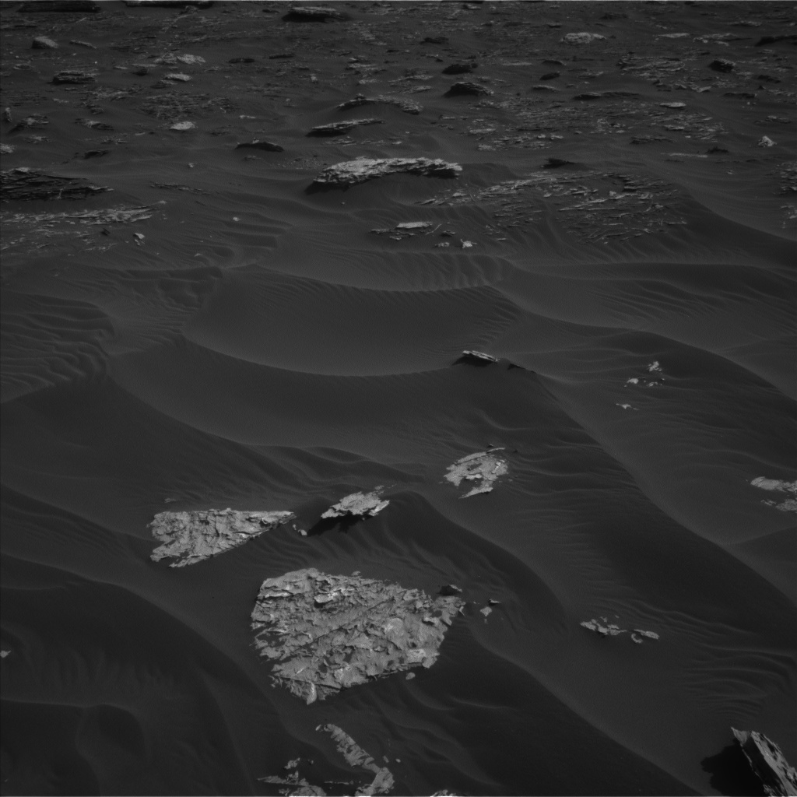
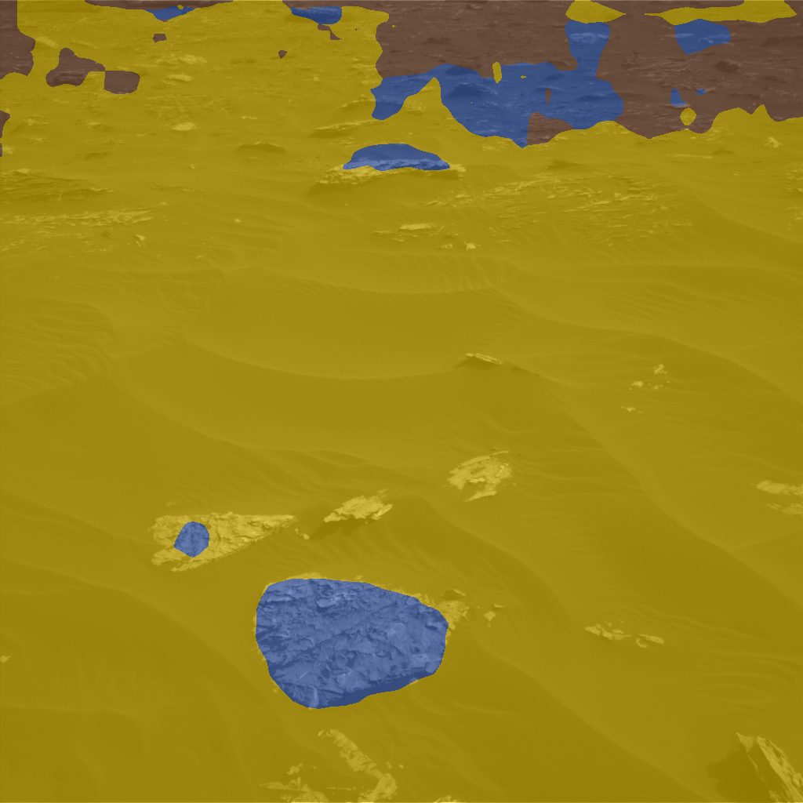
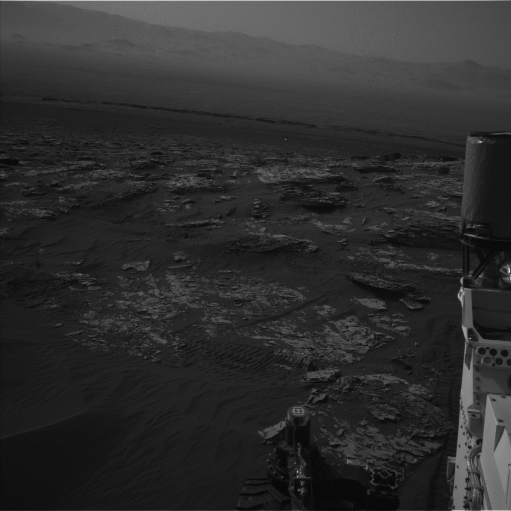
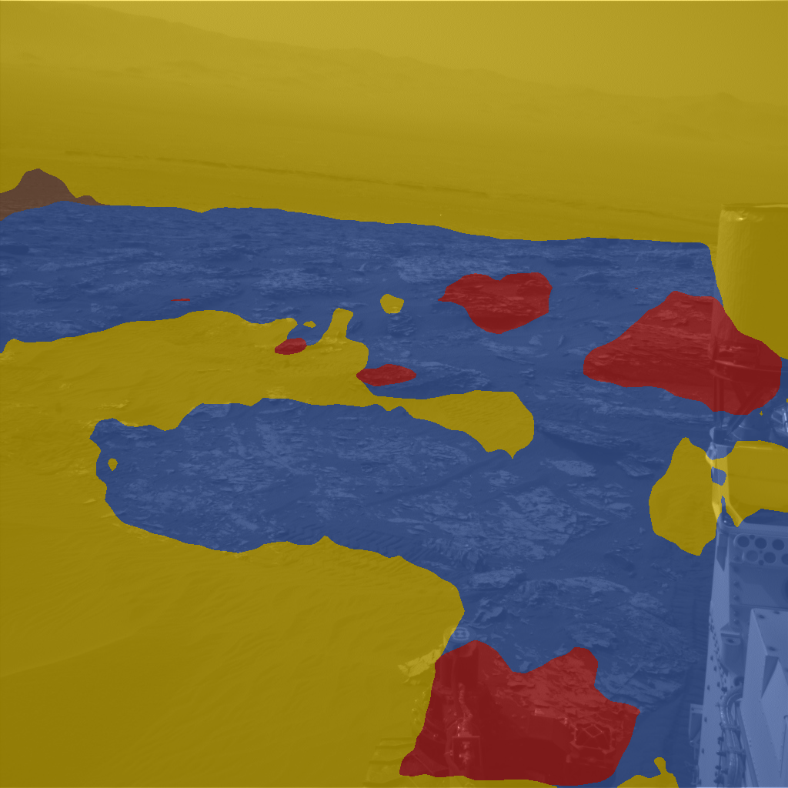
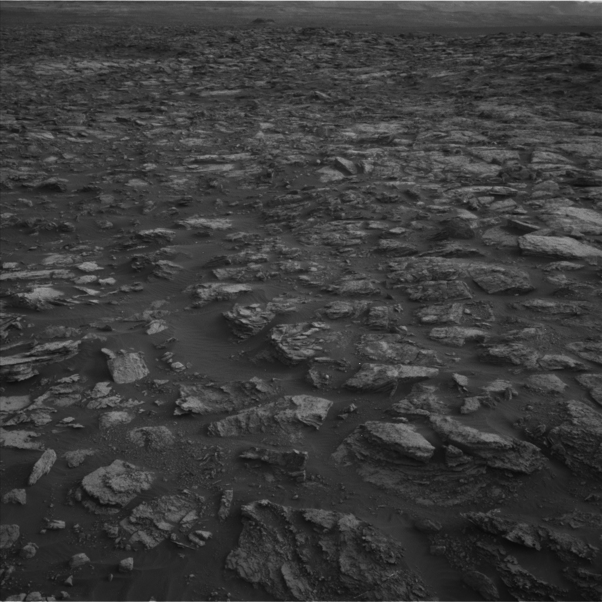
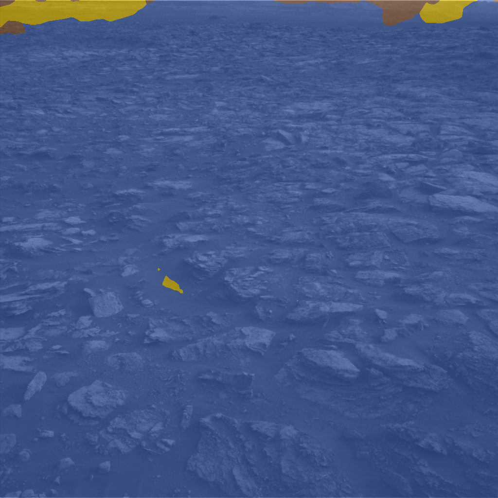
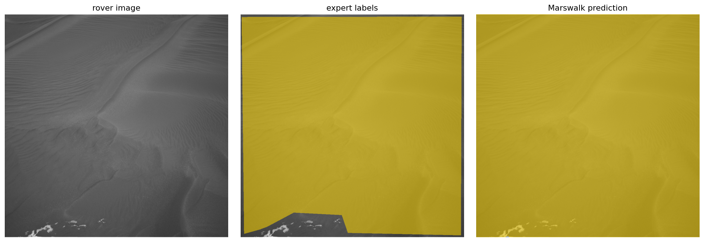
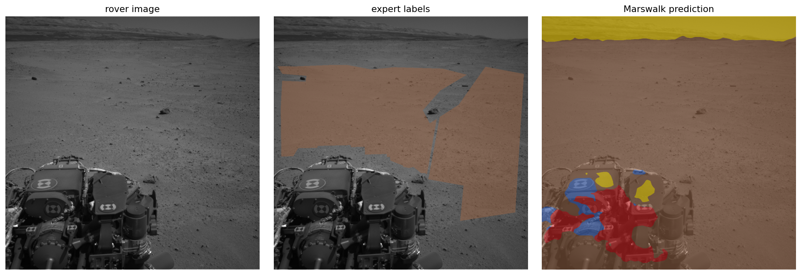

# Marswalk — Terrain-Safety Traverse Planning for Mars Surface Crews

A terrain-safety traverse planner that labels every pixel of Mars rover imagery as soil, bedrock, sand or big rock, then plans a crew route that avoids the ground that ended Spirit's mission.

Built for the NASA Space Apps Challenge 2026, challenge *Interplanetary Survival Guide: Martian Map*.

[](https://www.python.org/)
[](https://pytorch.org/)
[](#license)
[](https://ahmedyar7.github.io/MarsWalk/)
[](https://huggingface.co/spaces/ahmedyar/marswalk)

<table>
  <tr>
    <td width="50%"></td>
    <td width="50%"></td>
  </tr>
  <tr>
    <td align="center"><sub>ST-11, raw rover frame</sub></td>
    <td align="center"><sub>Classified: 87.9% sand (yellow), 5.9% bedrock (blue), 6.2% soil (brown). Station hazard 0.879.</sub></td>
  </tr>
</table>

**Headline result:** on a 40.8 km traverse in Gale Crater, the Marswalk route is 17% longer than the straight line but has **40% less hazard exposure** (0.302 → 0.180). The terrain model scores **0.715 mIoU** on the held-out expert-labelled AI4Mars test set, compared with 0.128 for an all-soil baseline, and **0.913 IoU on sand**.

---

## Contents

- [The problem](#the-problem)
- [What it does](#what-it-does)
- [Results](#results)
- [The big rock number](#the-big-rock-number)
- [Gallery](#gallery)
- [How it works](#how-it-works)
- [Repository structure](#repository-structure)
- [Running it yourself](#running-it-yourself)
- [Limitations](#limitations)
- [Data and attribution](#data-and-attribution)
- [AI assistance](#ai-assistance)
- [License](#license)

---

## The problem

Crew safety is NASA's first priority on any surface mission. On Mars, the most dangerous property of the ground is whether it can bear weight, and that is very hard to see in an image. In 2009 the Spirit rover drove into soft soil and never moved again. A rover that becomes stuck loses its mission. A crew on foot or in a pressurised vehicle in the same situation would face a survival problem.

Existing tools work at a different scale:

| Tool | Scale | What it answers |
|---|---|---|
| Mars Trek | Regional to global | Where things are, what the topography looks like |
| USGS-NASA geologic maps | Regional to global | What geologic units underlie an area |
| **Marswalk** | **One excursion (tens of km)** | **Which ground along this walk is likely to be unsafe, and which way to go around it** |

Marswalk fills the gap at the scale of a single excursion. It combines what the rover cameras see at ground level with what orbital elevation data say about slope, and plans a route through both.

---

## What it does

Marswalk has two parts:

1. **Terrain classifier.** A DeepLabV3+ network with a ResNet-50 encoder, trained on NASA JPL's AI4Mars dataset, labels each pixel of a rover frame as one of four classes: soil, bedrock, sand or big rock. Sand and big rock count as hazardous.
2. **Traverse planner.** Per-frame hazard scores are interpolated across a Gale Crater elevation model, combined with slope into a cost surface, and solved with A* to give a route from the habitat to a science target.

It uses three data layers:

| # | Layer | Source | Resolution / extent |
|---|---|---|---|
| 1 | Optical | Curiosity rover imagery (AI4Mars test frames) | 12 imaging stations |
| 2 | Terrain classification (derived) | DeepLabV3+ / ResNet-50 trained on AI4Mars | Per-pixel, 4 classes |
| 3 | Topographic | MOLA/HRSC blended DEM, cropped to Gale Crater, plus a derived slope raster | 200 m/px, 207 × 207 grid |

### Pipeline

```text
 AI4Mars rover frames                      MOLA/HRSC blended DEM (200 m/px)
        │                                              │
        ▼                                              ▼
 prepare(): label mask + rover/range        crop to Gale Crater (137.4°E, 4.5°S, ±0.35°)
 masks → ignore index 255                                │
        │                                              ▼
        ▼                                     slope raster (degrees)
 DeepLabV3+ / ResNet-50                                  │
 (soil · bedrock · sand · big rock)                      │
        │                                              │
        ▼                                              │
 per-station hazard = share of frame                     │
 classified sand or big rock (12 stations)              │
        │                                              │
        ▼                                              ▼
 Gaussian interpolation (σ ≈ 15 cells) ──►  cost = 1 + 4·(min(θ,15°)/15°)² + 6·hazard
                                            cost = ∞ where θ > 15°
                                                       │
                                                       ▼
                                          A* (8-connected, octile heuristic)
                                                       │
                                                       ▼
                                   site.json  ──►  index.html (Leaflet traverse map)
```

---

## Results

### Terrain classification

Evaluated on AI4Mars `test_min3`: Curiosity frames whose labels were agreed by at least three experts. This split was held out of training and checkpoint selection.

| Model | mIoU | soil | bedrock | sand | big rock | pixel acc |
|---|---|---|---|---|---|---|
| All-soil baseline | 0.128 | 0.514 | 0.000 | 0.000 | 0.000 | 0.514 |
| **DeepLabV3+ (min3)** | **0.715** | **0.949** | **0.910** | **0.913** | **0.089** | **0.961** |
| DeepLabV3+ (min1) | 0.625 | 0.874 | 0.759 | 0.816 | 0.049 | 0.895 |

The baseline predicts soil everywhere. Its 0.514 pixel accuracy shows that soil makes up about half of the labelled test pixels, so pixel accuracy on its own says little about performance. The `min1` row uses the looser test split, where a single expert's label is enough, so it contains more label noise.

Per-class recall and precision on `test_min3`:

| Class | Recall (%) | Precision (%) | IoU |
|---|---|---|---|
| soil | 96.0 | 98.8 | 0.949 |
| bedrock | 94.9 | 95.8 | 0.910 |
| sand | 97.4 | 93.5 | 0.913 |
| big rock | 89.7 | 9.0 | 0.089 |

Sand matters most for safety, and it is the class with the highest recall: the model finds 97.4% of expert-labelled sand pixels.

### Traverse planning

Gale Crater, lower Mount Sharp. The objective is to characterise boxwork formations. The route runs from the habitat to the science target. All values below are read directly from [`site.json`](site.json).

| Metric | Direct (straight line) | Marswalk | Change |
|---|---|---|---|
| Distance | 40.8 km | 47.6 km | +6.8 km (+17%) |
| Mean hazard exposure | 0.302 | 0.180 | −40% |
| Mean slope | 1.4° | 2.3° | +0.9° |
| Max slope | 4.5° | 5.9° | +1.4° |
| Cells above 15° slope limit | 0.0% | 0.0% | — |

**17% extra distance buys 40% less hazard exposure.** The route takes on a little more slope (max 5.9°), but stays well under the 15° limit at every cell.

### Imaging stations

The 12 stations, ordered by measured hazard (values from `site.json`, coverage rounded to one decimal):

| Station | Hazard | Soil % | Bedrock % | Sand % | Big rock % | Slope (°) | Elevation (m) |
|---|---|---|---|---|---|---|---|
| ST-0 | 0.005 | 99.5 | 0.0 | 0.0 | 0.5 | 10.6 | −3826 |
| ST-1 | 0.015 | 0.7 | 97.8 | 1.6 | 0.0 | 4.1 | −4247 |
| ST-2 | 0.063 | 70.2 | 23.5 | 6.3 | 0.0 | 0.4 | −4526 |
| ST-3 | 0.069 | 0.1 | 93.0 | 5.4 | 1.5 | 4.1 | −4512 |
| ST-4 | 0.100 | 54.7 | 35.4 | 10.0 | 0.0 | 14.2 | −3605 |
| ST-5 | 0.122 | 87.8 | 0.0 | 12.2 | 0.0 | 1.5 | −4366 |
| ST-6 | 0.161 | 0.0 | 83.9 | 7.7 | 8.4 | 1.7 | −4496 |
| ST-7 | 0.186 | 81.4 | 0.0 | 15.3 | 3.4 | 2.8 | −4531 |
| ST-8 | 0.259 | 5.6 | 68.6 | 25.9 | 0.0 | 0.9 | −4257 |
| ST-9 | 0.356 | 15.0 | 49.4 | 35.2 | 0.4 | 1.3 | −4137 |
| ST-10 | 0.634 | 0.4 | 36.2 | 56.2 | 7.2 | 1.2 | −4462 |
| ST-11 | 0.879 | 6.2 | 5.9 | 87.9 | 0.0 | 1.6 | −4264 |

---

## The big rock number

Big rock is the weakest class by IoU: **0.089**. It needs a proper explanation, because the reason for the low score matters for safety.

**What the model gets right.** Big-rock recall is **89.7%**, so the model finds roughly nine out of ten real big-rock pixels. Missing obstacles is the dangerous kind of error, and the model rarely does it.

**What it gets wrong.** Big-rock precision is **9.0%**, so about 91% of the pixels the model calls big rock are something else. IoU combines both kinds of error. With recall near 0.9 and precision near 0.09, the formula gives 1 / (1/0.09 + 1/0.897 − 1) ≈ 0.089. Nearly all of the IoU penalty comes from false positives.

**Where the false positives come from.** **81%** of the big-rock false positives are pixels the experts labelled **bedrock**. That confusion is understandable: a big rock and an exposed bedrock slab are both hard, angular and lit the same way, and at 256 × 256 input resolution the difference often comes down to whether the edge of the outcrop is visible. The model is not mistaking sand or soil for boulders. It is mistaking one kind of hard ground for another.

**Why the error is acceptable for this use.** In the planner, big rock counts as hazard and bedrock does not. When bedrock is called big rock, the hazard estimate goes up, the cost surface becomes more expensive, and A* routes around ground that was safe. The route gets longer but no less safe. The opposite error, calling big rock bedrock, would lower the hazard estimate and send a crew into an obstacle field. The model makes that error on only about 10% of real big-rock pixels.

In short, **the model over-calls obstacles, so it fails in the safe direction.** The cost of this behaviour is extra distance, not extra exposure.

**Why it could also look worse than it is.** Big rock covers small areas of each frame (no station in `site.json` exceeds 8.4% big rock), so true big-rock pixels are few. With so few of them, a modest number of false positives on the much larger bedrock class is enough to drive precision down. The `min1` split, with looser labels, gives an even lower 0.049.

**What would improve it.** Training at a higher input resolution than 256 × 256, using more than the 3,600 training images used here, or adding a boundary-aware loss would all target the bedrock/big-rock edge. None of these were tried within the hackathon time budget.

---

## Gallery

<table>
  <tr>
    <td width="50%"></td>
    <td width="50%"></td>
  </tr>
  <tr>
    <td colspan="2" align="center"><sub><b>ST-10</b>: mixed sand and bedrock. 56.2% sand, 36.2% bedrock, 7.2% big rock. Hazard 0.634, the second-highest station.</sub></td>
  </tr>
  <tr>
    <td width="50%"></td>
    <td width="50%"></td>
  </tr>
  <tr>
    <td colspan="2" align="center"><sub><b>ST-1</b>: bedrock pavement. 97.8% bedrock, 1.6% sand. Hazard 0.015, among the safest ground in the survey.</sub></td>
  </tr>
</table>

<p align="center">
  
  <br>
  <sub><b>Rover image, expert labels, Marswalk prediction</b> on a held-out dune frame. The model's sand matches the expert annotation across the whole field. The light outcrop at the bottom edge is left unlabelled by the experts and is ignored in scoring.</sub>
</p>

<p align="center">
  
  <br>
  <sub><b>Why the ignore masks matter.</b> The soil plain is classified correctly, but the model paints the rover deck as big rock and bedrock and the distant ridge and sky as sand. None of those regions carry a ground-truth label. The rover mask and range mask set them to 255, so they are excluded from every metric. The same regions do still count toward a frame's raw hazard share (see Limitations).</sub>
</p>

---

## How it works

### Data handling

The AI4Mars rows used here come from the [`hassanjbara/AI4MARS`](https://huggingface.co/datasets/hassanjbara/AI4MARS) dataset on Hugging Face. Each row has an image, a label mask, and optionally a rover mask and a range mask. The `prepare()` function in the notebook does the following:

- **Ignore index 255.** Pixels with no label already carry value 255. Any pixel where the **rover mask** (the rover's own hardware in frame) or the **range mask** (ground too far from the camera to label reliably) is non-zero is also set to 255. The loss function uses `ignore_index=255`, and every evaluation filters with `lab != 255`, so these pixels never contribute to training or to any metric.
- **Labelled rows only.** Only rows with `has_labels == True` are used. A fixed-seed (`42`) shuffle picks 4,000 of them. The first 10% (400) form the validation set and the remaining **3,600** form the training set.
- **Resizing rule.** Images are resized to 256 × 256 with **bilinear** interpolation. Masks are resized with **nearest-neighbour** interpolation. Bilinear resizing would blend class IDs at boundaries into values that are not real classes (for example, averaging soil `0` and sand `2` gives bedrock `1`) and would blend the 255 ignore value into valid IDs. Nearest-neighbour keeps every mask pixel a valid class or 255.
- **Full-resolution evaluation.** At test time the logits are upsampled back to the original label size with bilinear interpolation before `argmax`, so metrics are computed against the original expert masks, not resized copies.

### Training

| Setting | Value |
|---|---|
| Architecture | DeepLabV3+ (`segmentation-models-pytorch`) |
| Encoder | ResNet-50, ImageNet weights |
| Classes | 4 (soil, bedrock, sand, big rock) |
| Loss | Weighted cross-entropy, weight = 1 − class share of training pixels, `ignore_index=255` |
| Optimiser | AdamW, lr 3e-4, weight decay 1e-4 |
| Batch size | 8 |
| Precision | Mixed (`torch.amp` autocast + GradScaler) |
| Epochs | 6 |
| Training images | 3,600 at 256 × 256 |
| Augmentation | Horizontal flip (p = 0.5) applied identically to image and mask; brightness jitter ×U(0.8, 1.25) on the image only |
| Normalisation | ImageNet mean/std |
| Checkpoint selection | Best validation mIoU: epoch 4, val mIoU 0.767 |
| Compute | ~1 hour on a single free-tier GPU |

The class weights reduce the influence of soil, which dominates the pixel count, and give more weight to the rarer sand and big-rock classes.

### Cost surface

The DEM is the MOLA/HRSC blended product at 200 m/px. It is read with a window of ±0.35° around 137.4°E, 4.5°S and average-resampled to a 207 × 207 grid at 200.1 m/px. Degrees are converted to metres on a sphere of radius 3,396,190 m. Slope θ comes from `np.gradient` on that grid.

Per-cell traversal cost:

```text
cost = 1 + 4 · (min(θ, 15°) / 15°)² + 6 · hazard
cost = ∞                              where θ > 15°
```

| Term | Meaning |
|---|---|
| `1` | Base cost per unit distance, so flat, safe ground still has a length penalty |
| `4 · (θ/15°)²` | Quadratic slope penalty, reaching 4 at the limit |
| `6 · hazard` | Terrain penalty, weighted more heavily than slope |
| `∞` above 15° | Hard limit; **11.4%** of cells are impassable |

**Hazard field.** Each of the 12 stations has a hazard score equal to the share of its frame's pixels that the model classifies as sand or big rock. These point values are spread across the grid with a normalised Gaussian kernel, `σ = max(H, W) / 14 ≈ 15 cells ≈ 3 km`. Each cell's hazard is the kernel-weighted mean of the station values.

### Route search

- **A\*** on the 8-connected grid. Orthogonal steps cost `1 × cell cost` and diagonal steps cost `√2 × cell cost`.
- **Heuristic:** octile distance, `max(dy, dx) + (√2 − 1)·min(dy, dx)`. Every cell costs at least 1, so this heuristic is admissible.
- **Endpoints:** the habitat is at grid position (0.85 H, 0.15 W) and the science target at (0.15 H, 0.85 W). Each is snapped to the nearest finite-cost cell.
- **Comparison baseline:** a rasterised straight line between the same endpoints.
- **Scoring:** both paths are de-duplicated before measurement. Distance sums 200.1 m per orthogonal step and 200.1·√2 m per diagonal step. Slope and hazard are averaged over the cells each path visits.
- **Export:** every third route cell is written to `site.json` as lon/lat, together with stations, stats and model metrics. `index.html` reads that file and draws the map.

---

## Repository structure

```text
MarsWalk-Site/
├── .github/
│   └── workflows/
│       └── static.yml          # GitHub Pages deployment on push to main
├── assets/
│   ├── st0_raw.png … st11_raw.png    # 12 station frames, raw
│   ├── st0_seg.png … st11_seg.png    # classified overlays (st6_seg.png not present)
│   ├── examples/               # 6 demo inputs for the Hugging Face Space, named by hazard %
│   │   ├── 1_hazard00pct.png
│   │   ├── 2_hazard03pct.png
│   │   ├── 3_hazard16pct.png
│   │   ├── 4_hazard21pct.png
│   │   ├── 5_hazard100pct.png
│   │   └── 6_hazard100pct.png
│   ├── figs/
│   │   └── figs/
│   │       └── fig1.png … fig6.png   # rover image | expert labels | prediction panels
│   └── frames/
│       └── wp0_raw.png … wp7_seg.png # 8 frames spanning the hazard range, raw + classified
├── index.html                  # Live traverse map (Leaflet 1.9.4), reads site.json
├── site.json                   # Route, direct line, 12 stations, model metrics, cost params
└── Marswalk.ipynb              # Training, evaluation, export, DEM processing, planning (Colab)
```

---

## Running it yourself

All training and planning code lives in [`Marswalk.ipynb`](Marswalk.ipynb). It was written for Google Colab with a GPU runtime and Google Drive for checkpoints. It is a working notebook rather than a packaged library, so some cells are earlier versions of later ones (for example, three DEM loading cells, of which the last one, the windowed Gale Crater crop, is the one used).

### 1. Install

```bash
pip install torch segmentation-models-pytorch datasets gradio rasterio matplotlib numpy pillow
```

### 2. Get the data

**AI4Mars** downloads automatically on first use:

```python
from datasets import load_dataset
full_train = load_dataset("hassanjbara/AI4MARS", split="train")
test_min3  = load_dataset("hassanjbara/AI4MARS", split="test_min3")
test_min1  = load_dataset("hassanjbara/AI4MARS", split="test_min1")
```

**DEM.** Download the MOLA/HRSC blended DEM from [JPL Mars Trek](https://trek.nasa.gov/mars/) and set `DEM_PATH` in the notebook to point at it. The notebook expects this file name:

```text
Mars_MOLA_blend200ppx_HRSC_DEM_clon0dd_200mpp_lzw.tif
```

### 3. Train and evaluate

Set `CKPT_DIR` (default `/content/drive/MyDrive/ai4mars`), then run the notebook in order:

| Step | What runs |
|---|---|
| Data prep | `prepare()`, labelled-row selection, 256 × 256 caching, 90/10 split |
| Class weights | `1 − class share` over the training pixels |
| Baseline | All-soil confusion matrix on `test_min3` |
| Training | 6 epochs, best checkpoint saved to `CKPT_DIR/best.pt` |
| Evaluation | mIoU, per-class IoU, pixel accuracy and confusion matrix on `test_min3` and `test_min1` |

The sand error-analysis cell uses a `worst` list that is built in a cell not included in this notebook. Skip that cell, or rebuild `worst` as a list of `(row, score)` pairs for the test frames, before running it.

### 4. Plan the route

Run the DEM cell (windowed Gale Crater crop), then the station, hazard/cost and A\* cells. The planning cell prints straight-line and Marswalk stats along with the distance and hazard deltas. The export cell writes `figs/site.json` and `figs/route.png`, and the last cell writes the `st{id}_raw.png` / `st{id}_seg.png` station frames.

Copy `site.json` to the repository root and the station frames into `assets/`.

### 5. Serve the page

`index.html` loads `site.json` with `fetch`, so it needs to be served over HTTP rather than opened as a file:

```bash
python -m http.server 8000
# open http://localhost:8000/
```

Pushing to `main` deploys the page to GitHub Pages through [`.github/workflows/static.yml`](.github/workflows/static.yml).

### 6. Model demo

The Gradio cell starts the same interface as the [Hugging Face Space](https://huggingface.co/spaces/ahmedyar/marswalk). It returns a classified overlay, class coverage, and a verdict: *traversable* when hazard is 10% or less, *caution* between 10% and 30%, and *high hazard* above 30%.

---

## Limitations

1. **Station placement is illustrative: AI4Mars frames carry no rover coordinates; elevation, slope and the route are real geospatial data, and the terrain classification and all reported metrics are real.** Each of the 12 stations is placed at a random position (fixed seed) in the Gale Crater grid and assigned a real Curiosity test frame. The frame's measured composition then stands in for the ground at that position.
2. **The hazard field is interpolated from 12 point samples.** Between stations, hazard is a Gaussian-weighted average with σ ≈ 3 km, not an observation. A sand patch that falls between stations is not represented.
3. **The scales do not match.** A rover frame shows only the ground near the camera, but a DEM cell is 200 m across. One frame is used as the hazard value for the area around a station, far larger than what the frame actually shows.
4. **Slope is computed at 200 m/px.** Averaging smooths out local relief, so slopes a crew would meet on foot can be much steeper than the 5.9° route maximum. The 15° limit applies to 200 m averages, not to the real gradient underfoot.
5. **Visual class is a proxy for bearing strength.** The model classifies what the ground looks like. Soft ground under a crust, the kind of trap that stopped Spirit, can look like ordinary soil. "Sand" is a visual stand-in for low bearing strength, not a measurement of it.
6. **Big-rock precision is 9.0%.** As explained [above](#the-big-rock-number), the error leans toward caution, but it inflates hazard on bedrock and so lengthens routes over safe ground.
7. **Station hazard counts all predicted pixels, including masked regions.** When station hazard is computed, the rover and range masks are not applied, so predictions on rover hardware, distant terrain or sky (see the second gallery figure) can add to a frame's sand and big-rock share.
8. **The training budget is small.** The model was trained on 3,600 labelled frames at 256 × 256 for 6 epochs. Small rocks and fine sand ripples lose detail at that resolution, and a longer schedule or larger subset was not explored.
9. **The cost weights are hand-set.** The slope weight of 4, hazard weight of 6 and 15° limit were chosen by judgement, not calibrated against traversability or crew-mobility data. Different weights give a different route and a different distance–hazard trade-off.
10. **There is one route and one baseline, with no uncertainty.** Results cover a single habitat–target pair. The comparison is a straight line, not another planner, and the route does not carry model or interpolation uncertainty. The 17% / 40% figures describe this one case, not a general guarantee.

---

## Data and attribution

| Source | Use in Marswalk | Link |
|---|---|---|
| **AI4Mars** (NASA JPL): ~35k rover images, 326k crowdsourced labels, ~1.5k expert labels | Training and evaluation of the terrain classifier; station frames | Swan et al., *AI4Mars: A Dataset for Terrain-Aware Autonomous Driving on Mars*, CVPR Workshops 2021. Mirror used: [huggingface.co/datasets/hassanjbara/AI4MARS](https://huggingface.co/datasets/hassanjbara/AI4MARS) |
| **MGS MOLA / Mars Express HRSC blended DEM**, 200 m/px | Elevation and slope over Gale Crater | Via [JPL Mars Trek](https://trek.nasa.gov/mars/) |
| **NASA Mars Curiosity raw imagery** | Source imagery behind the AI4Mars Curiosity frames | [mars.nasa.gov/msl/multimedia/raw-images](https://mars.nasa.gov/msl/multimedia/raw-images/) |
| **USGS-NASA Planetary Geologic Mapping Program** | Regional geologic context for site selection | [usgs.gov/.../planetary-geologic-mapping](https://www.usgs.gov/centers/astrogeology-science-center/science/planetary-geologic-mapping) |

Software: PyTorch, `segmentation-models-pytorch`, Hugging Face `datasets`, Gradio, rasterio, NumPy, Matplotlib, Leaflet.

---

## AI assistance

An AI assistant was used for code scaffolding, debugging and documentation drafting. All model training, evaluation and result verification were performed and checked by the team. All reported metrics come from our own evaluation runs on the held-out AI4Mars expert test set.

---

## License

This repository does not yet include a license file. Until one is added, all rights are reserved by the authors. The datasets listed above remain under their own terms.

NASA does not endorse any non-U.S. Government entity and is not responsible for information contained on non-U.S. Government websites.
